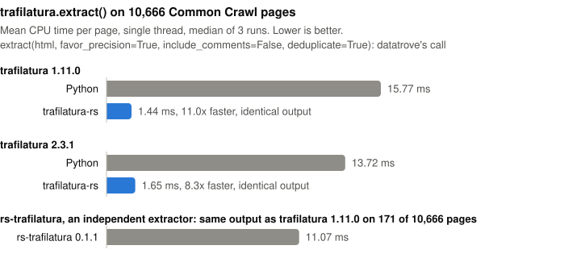

# trafilatura-rs

[](https://pypi.org/project/trafilatura-rs/)
[](https://pypi.org/project/trafilatura-rs/)
[](https://github.com/Hexay/trafilatura-rs/actions/workflows/ci.yml)
[](https://github.com/Hexay/trafilatura-rs/blob/main/LICENSE)

A Rust port of [trafilatura](https://github.com/adbar/trafilatura)'s extraction.

- **Exact.** Output is byte-identical to trafilatura 1.11.0 or 2.3.1, whichever is installed.
- **Fast.** Text extraction takes 8 to 11 times less CPU.
- **Drop-in.** It patches trafilatura in place, and any call it doesn't cover runs Python trafilatura unchanged.

<p align="center">
  
</p>

## Installation

```bash
pip install "trafilatura-rs[trafilatura]"    # trafilatura 1.11.0
pip install "trafilatura-rs[trafilatura2]"   # trafilatura 2.3.1
```

The extras pin the versions trafilatura-rs is checked against:

| Package | `[trafilatura]` | `[trafilatura2]` |
|---|---|---|
| trafilatura | 1.11.0 | 2.3.1 |
| lxml | 6.1.3 | 6.1.3 |
| htmldate (metadata) | 1.11.0 | 1.11.0 or newer, via trafilatura 2.3.1 |

Wheels are built for Linux (glibc and musl, x86_64 and aarch64), macOS (x86_64 and arm64) and Windows (x64 and
arm64), for Python 3.10+, with libxml2 statically linked.

## Quickstart

Run existing code unchanged:

```bash
TRAFILATURA_RS=1 python my_script.py    # or: python -m trafilatura_rs my_script.py
```

Or in code:

```python
import trafilatura_rs
trafilatura_rs.install()            # patches trafilatura, including copies imported earlier

from trafilatura_rs import extract  # or import the drop-in directly; same signature
```

The patch also reaches calls made inside other libraries, such as datatrove's `Trafilatura` step (see also
[datatrove-rs](https://github.com/Hexay/datatrove-rs)), and trafilatura's command line.

`trafilatura_rs.supports(**kwargs)` reports whether an `extract` call runs in Rust. `supports_bare_extraction`,
`supports_baseline`, `supports_html2txt`, `supports_extract_metadata` and `supports_find_date` do the same for the
other functions. `trafilatura_rs.engine()` returns the trafilatura version being reproduced.

## Coverage

Runs in Rust:

- **`extract()`** on str or bytes, or on an lxml tree with trafilatura 2.3.1.
  - **Output formats:** txt, markdown, json, xml, html and csv.
  - **Options:** metadata, comments, links, images, `favor_precision`, `favor_recall`, `no_fallback`/`fast`,
    `include_tables`, `deduplicate`, `url`, `options=Extractor(...)`, config files, blacklists, `prune_xpath` and
    `date_extraction_params`.
  - **`target_language`:** txt and json only. It uses a port of py3langid's classifier; close calls, where float32
    rounding could change the result, go to Python.
- **`bare_extraction()`**, including links, images and `deduplicate`.
- **Other functions:** `html2txt`, `baseline`, `extract_metadata` and htmldate's `find_date`.
- **Metadata:** title, author, date, sitename, categories, tags, license and JSON-LD. Dates use a port of htmldate,
  including the dateutil and dateparser calls it makes; rare date strings go to Python.
- **trafilatura's command line.**

Runs Python trafilatura:

- `target_language` with other output formats, or with links or images.
- lxml trees with trafilatura 1.11.0, which modifies the caller's tree, and any other input that isn't str, bytes or
  an lxml tree.
- 2.3.1's `deduplicate` with a caller-supplied `LRUCache`.
- Metadata on Python 3.10.
- Every call when the installed versions don't match (see Exactness).

With `deduplicate=True`, calls that run in Python share trafilatura-rs's deduplication cache, so output depends on
earlier pages exactly as it does in trafilatura. The verified configurations per output and function are listed in
[docs/coverage.md](https://github.com/Hexay/trafilatura-rs/blob/main/docs/coverage.md).

## Exactness

Every covered configuration is checked page by page against trafilatura 1.11.0 and 2.3.1 on 10,666 Common Crawl
pages, comparing the final output and per-stage tree hashes. Any difference is treated as a bug. The parser matches
too: trafilatura-rs statically links libxml2 2.14.6, the version lxml 6.1.3 bundles, with the same parsing options
([PATCHES.md](https://github.com/Hexay/trafilatura-rs/blob/main/crates/libxml2-sys/PATCHES.md)). Documents the port
declines inside a covered call rerun in Python.

Version guards keep results exact when other package versions are installed:

| Guard | Accepts | Otherwise |
|---|---|---|
| `REPRODUCES` | trafilatura 1.11.0 or 2.3.1 with lxml 6.0.0 to 6.1.3 | every call runs Python; `install()` warns and patches nothing |
| `REPRODUCES_METADATA` | htmldate 1.11.0 | metadata calls and `find_date` run Python |
| `REPRODUCES_DATES` | dateparser 1.5.0, python-dateutil 4.0.0 | htmldate's dateparser and dateutil calls run Python |

The guards are in `trafilatura_rs._versions`. `REPRODUCES` accepts every lxml 6.0.x and 6.1.x release, because
trafilatura's output under each one equals its output under 6.1.3 on the full corpus. Metadata also needs Python
3.11+. Differences between the two trafilatura versions are documented in
[docs/trafilatura-2x-diff.md](https://github.com/Hexay/trafilatura-rs/blob/main/docs/trafilatura-2x-diff.md) and
[docs/trafilatura-23-diff.md](https://github.com/Hexay/trafilatura-rs/blob/main/docs/trafilatura-23-diff.md).

## Speed

CPU time per page, Python trafilatura divided by trafilatura-rs, single thread. Times, instruction counts and machine
load are in [docs/benchmarks.md](https://github.com/Hexay/trafilatura-rs/blob/main/docs/benchmarks.md) and the
linked pull requests.

| Call | 1.11.0 | 2.3.1 | Pages | Source |
|---|---:|---:|---:|---|
| datatrove's call (`favor_precision`, `deduplicate`, no comments) | 11.0x | 8.3x | 10,666 | [benchmarks][b] |
| `extract(html)` | 8.8x | 8.5x | 10,666 | [benchmarks][b] |
| `extract(tree)`, lxml `HtmlElement` | Python | 9.7x | 10,562 | [#17][p17] |
| `output_format="markdown"` | 8.5x | 12.9x | 3,000 | [#7][p7] |
| `output_format` xml, html, csv (no comments) | 9.9-10.4x | 8.4-9.2x | 3,000 | [#13][p13] |
| `include_links` / `include_images` | 7.2-9.8x | 7.4-8.4x | 3,000 | [#13][p13] |
| command line (bytes, `options=Extractor()`) | 8.2x | 9.5x | 3,000 | [#7][p7] |
| `with_metadata=True, url=...` (no comments) | 4.7x | 4.9x | 3,000 | [#16][p16] |
| json with metadata (no comments), balanced / precision | 5.4x / 6.0x | 4.4x / 6.9x | 3,000 | [#16][p16] |
| `deduplicate` with metadata, txt (precision) and xml | 7.1-7.5x | 7.1-7.2x | 3,000 | [benchmarks][bd] |
| `bare_extraction`, links (with images and metadata) | 6.2-6.4x | 6.4-7.0x | 3,000 | [benchmarks][bd] |
| `bare_extraction`, `deduplicate`: precision / with metadata | 8.2x / 5.9x | 7.3x / 6.5x | 3,000 | [benchmarks][bd] |
| `bare_extraction`, each focus, with and without comments | 6.8-10.1x | 6.2-8.0x | 10,666 | [#10][p10] |
| `bare_extraction` with metadata and `url` | 2.4-3.2x | 3.0-3.6x | 10,666 | [#10][p10] |
| `html2txt` / `baseline` | 2.2x | 4.2-4.3x | 10,666 | [#10][p10] |
| `extract_metadata`, with and without `default_url` | 1.6-1.7x | 1.9-2.0x | 10,666 | [#10][p10] |
| `htmldate.find_date`, with and without `url` | 2.0-2.6x | 2.0-2.6x | 10,666 | [#10][p10] |

The 3,000-page runs count pages that rerun in Python against trafilatura-rs. The `bare_extraction` runs from #10 leave
out the 29 to 74 such pages per configuration.

[b]: https://github.com/Hexay/trafilatura-rs/blob/main/docs/benchmarks.md
[bd]: https://github.com/Hexay/trafilatura-rs/blob/main/docs/benchmarks.md#deduplication-with-metadata-bare_extraction-with-links-images-and-deduplicate
[p7]: https://github.com/Hexay/trafilatura-rs/pull/7
[p10]: https://github.com/Hexay/trafilatura-rs/pull/10
[p13]: https://github.com/Hexay/trafilatura-rs/pull/13
[p16]: https://github.com/Hexay/trafilatura-rs/pull/16
[p17]: https://github.com/Hexay/trafilatura-rs/pull/17

## Related projects

[rs-trafilatura](https://pypi.org/project/rs-trafilatura/) is a separate project: an independent extractor inspired
by trafilatura, not a port. With datatrove's call, its output equals trafilatura 1.11.0's on 171 of the 10,666 pages.

## Contributing

Development setup, the parity harness, benchmarks and releasing are covered in
[CONTRIBUTING.md](https://github.com/Hexay/trafilatura-rs/blob/main/CONTRIBUTING.md).

## License

Apache-2.0, like trafilatura. The vendored libxml2 is MIT-licensed, and win-iconv (Windows builds) is public domain.
trafilatura-rs is an independent project and is not affiliated with the trafilatura authors.
