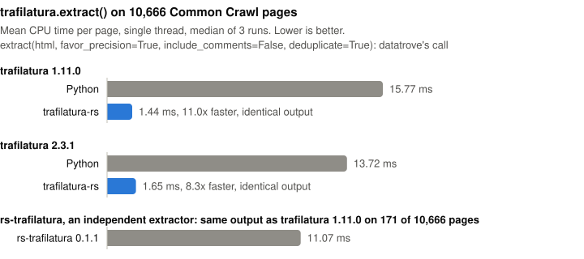

# trafilatura-rs

[](https://pypi.org/project/trafilatura-rs/)
[](https://pypi.org/project/trafilatura-rs/)
[](https://github.com/Hexay/trafilatura-rs/actions/workflows/ci.yml)
[](LICENSE)

A Rust port of [trafilatura](https://github.com/adbar/trafilatura)'s main-text extraction that returns **the same
output, byte for byte**, as `trafilatura.extract()`, using about a tenth of the CPU.

<p align="center">
  
</p>

## Installation

```bash
pip install "trafilatura-rs[trafilatura]"    # trafilatura 1.11.0
pip install "trafilatura-rs[trafilatura2]"   # trafilatura 2.3.1
```

trafilatura-rs reproduces whichever of the two is installed (2.3.1 when neither is). The extras install the versions
it is verified against (`[trafilatura]`: trafilatura 1.11.0, lxml 6.0.0–6.1.3, htmldate 1.11.0;
`[trafilatura2]`: trafilatura 2.3.1, lxml 6.0.0–6.1.3; htmldate 1.11.0 itself requires lxml 6.1.3, and with an
older htmldate metadata calls stay on Python), so you can fall back to and compare with the original. Wheels
are built for Linux (glibc and musl, x86_64 and aarch64), macOS and Windows (x64 and arm64), Python 3.10+, with
libxml2 statically linked.

## Quickstart

Your existing code, unchanged:

```bash
TRAFILATURA_RS=1 python my_script.py
```

Every `trafilatura.extract` call trafilatura-rs supports now runs in Rust; every other call runs Python trafilatura
as before. That includes calls made inside other libraries; datatrove's `Trafilatura` step, for example, is covered
(or use [datatrove-rs](https://github.com/Hexay/datatrove-rs)).

Prefer it in code? Any of these works too:

```python
import trafilatura_rs
trafilatura_rs.install()          # patch trafilatura.extract, including copies imported earlier

from trafilatura_rs import extract  # or swap the import: same signature, falls back to Python when needed
```

You can also run a script unmodified with `python -m trafilatura_rs my_script.py`.

`trafilatura_rs.supports(**kwargs)` tells you which path a call takes, and `trafilatura_rs.engine()` which
trafilatura version is reproduced. If your installed trafilatura or lxml isn't a pair trafilatura-rs reproduces
(`trafilatura_rs.REPRODUCES`), every call stays on Python and `install()` warns, so results never change. Markdown,
JSON and metadata output are covered too (see below).

## What's supported

`extract()` on str or bytes, in the configurations below (`trafilatura_rs.verified_outputs()`). Other arguments and
output formats run Python trafilatura. bytes are decoded by the installed trafilatura's own `decode_file` (as its
`load_html` does), then extracted in Rust; that includes the trafilatura command line, which passes file contents
as bytes with `options=Extractor(...)`.

Plain text, identical pages out of 10,666, with comments (`include_comments=True`, trafilatura's default) and
without:

| Configuration | Arguments | 1.11.0 | 1.11.0, no comments | 2.3.1 | 2.3.1, no comments |
|---|---|---|---|---|---|
| Default | | 10,666 | 10,666 | 10,666 | 10,666 |
| Precision | `favor_precision=True` | 10,666 | 10,666 | 10,666 | 10,666 |
| datatrove / FineWeb | `favor_precision=True, deduplicate=True` | 10,666 | 10,666 | 10,666 | 10,666 |
| Recall | `favor_recall=True` | 10,666 | 10,666 | 10,666 | 10,666 |
| Fast | `no_fallback=True` (2.3.1: also `fast=True`) | 10,666 | 10,666 | 10,666 | 10,666 |
| No tables | `include_tables=False` | 10,666 | 10,666 | 10,666 | 10,666 |

With 2.3.1, `deduplicate` given an `LRUCache` runs Python trafilatura.

Markdown, JSON and metadata: every output below with each of default, `favor_precision=True`, `favor_recall=True`
and fast (`no_fallback`/`fast`), with and without comments, gives identical pages, 10,666 out of 10,666, on both
1.11.0 and 2.3.1:

| Output | Arguments |
|---|---|
| Markdown | `output_format="markdown"` (or `include_formatting=True` with txt) |
| Text with metadata | `with_metadata=True` |
| JSON | `output_format="json"` |
| JSON with metadata | `output_format="json", with_metadata=True` |
| Markdown with metadata | `output_format="markdown", with_metadata=True` (default focus only) |

`url` and `record_id` can be passed with any of them. `deduplicate=True` is verified with the precision and recall
configurations. Like trafilatura, it keeps a process-global cache, so output depends on document order exactly as in
Python; `trafilatura_rs.reset_caches()` clears it.

These options combine with any configuration above, each verified on the full corpus for both versions:

- `options=Extractor(...)`, `config=` / `settingsfile=` (settings.cfg sizes, `MAX_TREE_SIZE` in 2.3.1,
  `EXTENSIVE_DATE_SEARCH`), `max_tree_size=` (1.11)
- `url_blacklist`, `author_blacklist`, `only_with_metadata`, `prune_xpath` (expressions selecting elements; anything
  else runs Python)
- `date_extraction_params` with `original_date`, `extensive_search`, `max_date` (and `outputformat="%Y-%m-%d"`)
- bytes input

A call with `favor_precision=True, favor_recall=True` is the recall call (trafilatura gives recall precedence).

### Metadata

```python
trafilatura.extract(html, with_metadata=True, url=url)                  # Rust: text with a --- header
trafilatura.extract(html, output_format="json", with_metadata=True)    # Rust
trafilatura.extract(html, with_metadata=True, deduplicate=True)        # Python
```

Title, author, date, sitename, categories, tags, license and the JSON-LD parsing run in Rust, including a port of
htmldate 1.11's `find_date` (the htmldate both trafilatura versions resolve). A few leaves run in Python: courlan's URL helpers, and the dateutil and dateparser
calls htmldate makes for unusual date strings. Those calls cost little and keep results exact for any installed
version. Metadata calls therefore need trafilatura installed and Python 3.11+. They also need htmldate 1.11.0
(`REPRODUCES_METADATA`); with another version they stay on Python.

As in trafilatura, the date search is bounded by today's date (`max_date`). `date_extraction_params` is supported
when it sets `max_date` and optionally `original_date` / `extensive_search`. `with_metadata=True` with `deduplicate=True` stays on Python, because a document that
needs Python would update the wrong deduplication cache. Rare documents the port leaves to Python (listed in
[docs/metadata-formats-scope.md](docs/metadata-formats-scope.md)) are rerun there automatically. None occur in the
10,666-page corpus.

## Exactness

Each configuration is checked page by page against trafilatura 1.11.0 and 2.3.1 on 10,666 Common Crawl pages,
comparing final output and per-stage tree hashes. The jusText and readability fallbacks are checked separately.
Exactness holds because the parser is the same: trafilatura-rs vendors and statically links libxml2 2.14.6, the
version lxml 6.1.3 bundles, with the same parsing options (see [PATCHES.md](crates/libxml2-sys/PATCHES.md)).
trafilatura's output under every other lxml 6.0.x/6.1.x release (libxml2 2.14.4 to 2.14.6) is identical to its
output under 6.1.3 on the full corpus (default, FineWeb, markdown-with-comments and JSON-with-metadata calls, both
versions); any other lxml runs Python.
What changed between the two versions: [docs/trafilatura-2x-diff.md](docs/trafilatura-2x-diff.md) and
[docs/trafilatura-23-diff.md](docs/trafilatura-23-diff.md).

### How is this different from rs-trafilatura?

[rs-trafilatura](https://pypi.org/project/rs-trafilatura/) is an independent extractor inspired by trafilatura,
not a port. On the same 10,666 pages its output equals trafilatura's on 171. It never returns `None`, separates
paragraphs differently and often selects different content. Use trafilatura-rs when you need trafilatura's results,
for example to reproduce a dataset.

## Benchmark

Single thread, CPU time per page, 10,666 Common Crawl pages, `favor_precision=True` (`tools/bench.sh`):

| | mean | p50 | p99 | Speedup |
|---|---:|---:|---:|---:|
| trafilatura 1.11 | 17.93 ms | 11.19 ms | 110.83 ms | 1x |
| rs-trafilatura 0.1.1 | 12.24 ms | 7.66 ms | 81.88 ms | 1.5x |
| **trafilatura-rs** | **1.92 ms** | **1.25 ms** | **11.85 ms** | **9.3x** |

Measured by instruction count, the speedup is 11.3x.

The default call, `extract(html)` (comments included, `CALL=default tools/bench.sh`):

| | mean | p50 | p99 | Speedup |
|---|---:|---:|---:|---:|
| trafilatura 1.11 | 12.56 ms | 7.91 ms | 78.49 ms | 1x |
| rs-trafilatura 0.1.1 | 9.63 ms | 6.20 ms | 61.98 ms | 1.3x |
| **trafilatura-rs** | **2.10 ms** | **1.53 ms** | **10.91 ms** | **6.0x** |

Measured by instruction count, the speedup is 7.1x.

trafilatura 2.3.1 (first 3,000 pages, `V=23 tools/bench.sh 3000`, mean CPU time per page):

| Call | trafilatura 2.3.1 | trafilatura-rs | Speedup (CPU) | Speedup (instructions) |
|---|---:|---:|---:|---:|
| datatrove / FineWeb (`favor_precision=True, deduplicate=True`) | 10.58 ms | 2.51 ms | 4.2x | 4.1x |
| `extract(html)` | 12.92 ms | 2.63 ms | 4.9x | 5.0x |

Markdown, metadata and JSON (first 3,000 pages, `include_comments=False`, `BENCH_CFG=<cfg> tools/bench.sh 3000`):

| Call | trafilatura 1.11 | trafilatura-rs | Speedup (CPU) | Speedup (instructions) |
|---|---:|---:|---:|---:|
| `output_format="markdown"` | 8.36 ms | 1.58 ms | 5.3x | 6.5x |
| `with_metadata=True, url=...` | 18.07 ms | 9.53 ms | 1.9x | 2.3x |
| `output_format="json", with_metadata=True` | 21.02 ms | 9.09 ms | 2.3x | 2.6x |

The same calls against trafilatura 2.3.1 (`V=23 BENCH_CFG=<cfg> tools/bench.sh 3000`):

| Call | trafilatura 2.3.1 | trafilatura-rs | Speedup (CPU) | Speedup (instructions) |
|---|---:|---:|---:|---:|
| `output_format="markdown"` | 18.70 ms | 3.88 ms | 4.8x | 4.4x |
| `with_metadata=True, url=...` | 41.07 ms | 16.14 ms | 2.5x | 2.5x |
| `output_format="json", with_metadata=True` | 36.82 ms | 13.22 ms | 2.8x | 2.5x |

With comments (trafilatura's default), and the command line's call (`extract(bytes, options=Extractor())`), first
3,000 pages:

| Call | trafilatura 1.11 | trafilatura-rs | Speedup (CPU) | trafilatura 2.3.1 | trafilatura-rs | Speedup (CPU) |
|---|---:|---:|---:|---:|---:|---:|
| `output_format="markdown"` | 9.65 ms | 1.14 ms | 8.5x | 21.08 ms | 1.64 ms | 12.9x |
| `with_metadata=True, url=...` | 30.69 ms | 11.75 ms | 2.6x | 37.92 ms | 10.90 ms | 3.5x |
| `output_format="json", with_metadata=True, url=..., record_id=...` | 26.01 ms | 8.72 ms | 3.0x | 39.11 ms | 10.19 ms | 3.8x |
| command line, bytes input | 16.26 ms | 1.98 ms | 8.2x | 20.51 ms | 2.16 ms | 9.5x |

Mean CPU time per page. With metadata, about half of the remaining time is dateparser, which htmldate calls for
unusual date strings and which trafilatura-rs calls back into rather than ports (see
[docs/metadata-formats-scope.md](docs/metadata-formats-scope.md)).

## Contributing

Development setup, the parity harness, benchmarks and releasing: [CONTRIBUTING.md](CONTRIBUTING.md).

## License

Apache-2.0, like trafilatura. Vendored libxml2 is MIT-licensed; win-iconv (Windows builds) is public domain.
trafilatura-rs is an independent project and is not affiliated with the trafilatura authors.
